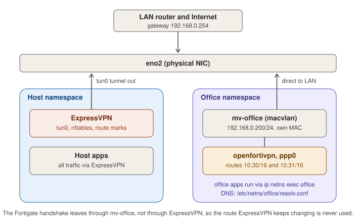

# Solutions

## Ubuntu: openfortivpn in a network namespace (tested by hand, working)
The namespace `office` has its own routing table, resolv.conf and firewall, and a macvlan NIC on the LAN. openfortivpn runs inside it, so its routes and DNS apply only to processes started in that namespace. ExpressVPN's rules live in the host namespace and never see it; that avoids both ExpressVPN's port 53 block and its habit of routing the Fortigate gateway through its own tunnel.



*The office namespace has its own NIC on the LAN, so the Fortigate handshake never uses ExpressVPN.*

Test result (2026-10-03): wired (by hand, macvlan) and Wi-Fi (through the script, ipvlan) both worked. Gateway pings from the namespace at TTL 247 (2 to 13 ms), tunnel up and stable for about 10 minutes wired and about 15 minutes on Wi-Fi, internal DNS (picked up automatically) and TCP to the git host work. Not yet tested for hours, with `git`/`ssh`/browser as the normal user, after a reboot, or when switching back to wired.

Usage (the script detects interface, gateway, link type, a free address and the office DNS servers itself; run on Wi-Fi):
```
sudo office-netns up
sudo office-netns vpn                  # prompts for the VPN password
sudo office-netns run ssh user@<office-host>
sudo office-netns refresh              # after switching LAN <-> Wi-Fi, then run vpn again
sudo office-netns down
```
Install: `sudo apt install openfortivpn iputils-arping`. Full commands, test results, limits and what did not work are in [ubuntu-README.md](ubuntu-README.md).

Limits: wired and Wi-Fi are tested on one network; a network change needs `refresh` and a new tunnel; only processes started in the namespace reach the intranet. The earlier veth + NAT variant was not needed and was not tested.

## Windows: ExpressVPN always on, office over the LAN or through FortiClient
See [windows-README.md](windows-README.md) for the full procedure. In short:
- ExpressVPN stays connected: split tunneling on, All Other Apps = Use VPN.
- Office network mode (default, not yet tested): the LAN/Wi-Fi already reaches the office; the office ranges are in ExpressVPN's IP bypass list, so office traffic leaves through the physical NIC.
- FortiClient mode (optional, tested and working): bypass the three FortiClient executables and the FortiGate gateway IP (/32), and remove the office ranges from the IP list (they would hijack routes away from the Forti tunnel). Connect ExpressVPN first, then FortiClient.
- DNS, both modes: `office-dns-permit.ps1` adds NRPT rules for the internal domain and WFP permits for port 53 to the internal DNS servers ([expressvpn-windows-dns.md](expressvpn-windows-dns.md)); browser DNS-over-HTTPS is turned off.

Windows has no equivalent of Linux network namespaces for this, so split tunneling plus NRPT and the port 53 permit is the working approach.

## Verification checklist
- Host public IP is the ExpressVPN exit (both OSes).
- Office host reachable by name and IP from the office path only (Windows: the physical NIC in office network mode, the Forti adapter in FortiClient mode).
- Disconnect the office VPN (FortiClient / openfortivpn); ExpressVPN keeps working. Disconnect ExpressVPN; office access keeps working.
