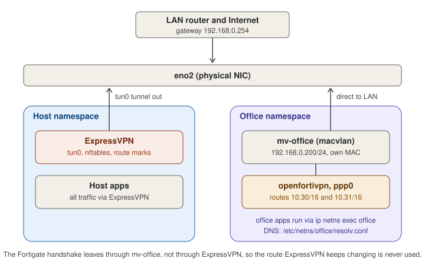

# ExpressVPN + openfortivpn on Ubuntu 24.04

Ubuntu counterpart of [windows-README.md](windows-README.md): ExpressVPN for general traffic, openfortivpn for the `office-domain.example` intranet.

**Status (2026-10-03):** Working with a network namespace, on wired and on Wi-Fi. openfortivpn runs inside a namespace with its own NIC on the LAN; ExpressVPN stays connected on the host. Wired (macvlan, commands run by hand): about 10 minutes, about 290 pings to the Fortigate, all TTL 247, tunnel never dropped. Wi-Fi (ipvlan, run through `scripts/office-netns.sh`): the script detected the interface, gateway, link type and a free address, the tunnel came up, the DNS servers were picked up automatically, and a soak of about 15 minutes (about 445 pings) stayed at TTL 247 with no drop. Not yet tested: a long soak (hours), `git`, `ssh` and a browser as the normal user, a reboot, and switching back from Wi-Fi to wired with `refresh`.

## Environment

| Item | Value |
|---|---|
| Fortigate gateway | `203.0.113.10` (custom port) |
| Routes pushed by Forti | `10.30.0.0/16`, `10.31.0.0/16` |
| Internal DNS | `10.30.63.3`, `10.30.63.2` |
| Internal suffix | `office-domain.example` |
| Physical NIC | `eno2` (wired), `192.168.0.148/24`, gateway `192.168.0.254` |
| Namespace | `office`, macvlan `mv-office`, address `192.168.0.200/24` (checked unused with `arping`) |
| ExpressVPN | Linux Qt app v14.3 |



*The office namespace has its own NIC on the LAN, so the Fortigate handshake never uses ExpressVPN.*

## Why a namespace

On the host, ExpressVPN breaks openfortivpn in two ways:

1. **DNS.** ExpressVPN's leak protection rejects all port 53 traffic in nft chain `evpn.r.310.blockDNS` (table `ip filter`). The kill switch toggle, app bypass and IP bypass do not exempt DNS. A narrow nft exception plus `resolvectl` routing domain works around it (see "Host workaround" below).
2. **Tunnel drops.** ExpressVPN keeps routing `203.0.113.10` through its own `tun0`. Pings to the gateway alternate between TTL 247 (~3 ms, direct) and TTL 235 (~450 ms, via ExpressVPN), and the PPP keepalives starve: "No response to 4 echo-requests", usually within 1 to 3 minutes. No host-side fix worked (see "What did not work").

Inside a namespace, ExpressVPN's rules, routes and firewall (all in the host namespace) never apply. A macvlan NIC also keeps the gateway traffic off the host routing table entirely.

## Setup with the script (auto-detects the network)

`scripts/office-netns.sh` works out the network-specific values itself, so nothing is hard-coded to `eno2` or `192.168.0.x`:

| Value | How it is found |
|---|---|
| Uplink interface | Physical interface with the lowest-metric default route (wired wins over Wi-Fi when both are up); virtual interfaces such as `tun0` are ignored |
| Gateway | The gateway of that route |
| Link type | `macvlan` on wired NICs; `ipvlan` (L2) on Wi-Fi, because an access point only accepts the MAC of the associated station |
| Office address | Unused address near the top of the subnet, checked with `arping -D`; the choice is remembered per network in `/var/lib/office-netns/` |
| Office DNS | The servers the Fortigate announces after login (the `ns [...]` line of openfortivpn's output), written to the namespace's `resolv.conf` |

```bash
sudo apt install openfortivpn iputils-arping
sudo ./scripts/office-netns.sh up         # creates the namespace and prints what it detected
sudo ./scripts/office-netns.sh vpn        # starts the tunnel; DNS is filled in once it is up
sudo ./scripts/office-netns.sh status
sudo ./scripts/office-netns.sh run ssh user@10.30.x.x
```
Overrides if detection is wrong: `OFFICE_IFACE`, `OFFICE_GW`, `OFFICE_ADDR`, `OFFICE_LINK` (macvlan or ipvlan), `OFFICE_SEARCH` (DNS search suffix), `OFFICE_CONFIG`. The `ip-up.d` DNS hook must stay disabled (step 2 below).

Run on Wi-Fi (2026-10-03): `refresh` chose `wlo1`, `ipvlan`, `192.168.0.253/24` via `192.168.0.254`; `vpn` came up and wrote `10.30.63.3` and `10.30.63.2` into the namespace's `resolv.conf` by itself. Not run yet: the wired path through the script (it was tested by hand), and `down` followed by `up` on a different network.

### Switching between LAN and Wi-Fi

The namespace is tied to one uplink, subnet and gateway, and the tunnel's connection to the Fortigate starts from that address, so a network change always means a new namespace and a new tunnel:

```bash
sudo ./scripts/office-netns.sh refresh    # down + up, re-detects interface, gateway, link type and address
sudo ./scripts/office-netns.sh vpn
```
If both LAN and Wi-Fi are connected, the wired interface is used. Unplug the cable (or turn off wired) to use Wi-Fi.

Wi-Fi worked in the test: it uses ipvlan, which shares the Wi-Fi adapter's MAC. If the namespace cannot reach its gateway on another Wi-Fi (`sudo ip netns exec office ping <gateway>` fails), try `OFFICE_LINK=macvlan` to rule out ipvlan; some drivers and access points support neither, and then that network needs a different design (for example the veth + NAT variant, which would put the Fortigate traffic back through the host routing table). Captive portals and Wi-Fi client isolation will also block it.

## Manual setup (what the script does; tested by hand on wired)

Prerequisites: `sudo apt install openfortivpn iputils-arping`, `/etc/openfortivpn/config` filled in, wired `eno2`, ExpressVPN connected.

1. Check the network and pick an unused address:
```bash
ip -br addr show eno2
ip route show default
sudo arping -c 2 -I eno2 192.168.0.200      # no reply means it is free
```
2. Disable the old DNS hook so pppd does not run it inside the namespace:
```bash
sudo mv /etc/ppp/ip-up.d/office-dns /etc/ppp/ip-up.d/office-dns.disabled
```
3. Create the namespace:
```bash
NS=office
sudo ip netns add $NS
sudo ip link add link eno2 name mv-office type macvlan mode bridge
sudo ip link set mv-office netns $NS
sudo ip -n $NS link set lo up
sudo ip -n $NS link set mv-office up
sudo ip -n $NS addr add 192.168.0.200/24 dev mv-office
sudo ip -n $NS route add default via 192.168.0.254
sudo mkdir -p /etc/netns/$NS
printf 'nameserver 10.30.63.3\nnameserver 10.30.63.2\n' | sudo tee /etc/netns/$NS/resolv.conf
```
4. Check the gateway is reached directly:
```bash
sudo ip netns exec office ping -c 5 192.168.0.254
sudo ip netns exec office ping -c 10 203.0.113.10      # want ttl=247, a few ms
```
5. Start the tunnel inside the namespace:
```bash
sudo ip netns exec office openfortivpn -c /etc/openfortivpn/config --set-dns=0 --pppd-use-peerdns=0
```
`--set-dns=0` and `--pppd-use-peerdns=0` stop it rewriting the resolver; the static `/etc/netns/office/resolv.conf` is used.

The address, gateway and interface in these manual commands are specific to the current network; the script detects them instead. The namespace does not survive a reboot.

## Using it

Only processes started inside the namespace reach `10.30.*` and `10.31.*`:

```bash
sudo ip netns exec office sudo -u "$USER" ssh user@10.30.x.x
sudo ip netns exec office sudo -u "$USER" git clone git@git.office-domain.example:repo.git
sudo ip netns exec office sudo -u "$USER" firefox -no-remote -P office
```

`sudo -u "$USER"` keeps your keys and config. `sudo scripts/office-netns.sh run <command>` wraps this. The namespace default route goes straight to the LAN, not through ExpressVPN, so use it only for office tools.

Teardown: stop openfortivpn (Ctrl-C), then `sudo ip netns del office` and `sudo rm -rf /etc/netns/office`.

## Results of the test (2026-10-03)

| Check | Result |
|---|---|
| `ping 192.168.0.254` from the namespace | 5 of 5, ~0.9 ms (router accepts the extra MAC) |
| `ping 203.0.113.10` from the namespace | 10 of 10, TTL 247, ~4 ms (host side was alternating with TTL 235 before) |
| openfortivpn in the namespace | "Tunnel is up and running", `ppp0` `10.31.254.2` |
| Routes in the namespace | `10.30.0.0/16`, `10.31.0.0/16` on `ppp0`; gateway via `mv-office` |
| `getent hosts git.office-domain.example` in the namespace | `10.30.63.20` |
| `nc -zv git.office-domain.example 443` in the namespace | succeeded |
| Host `curl ifconfig.me` | ExpressVPN address (`198.51.100.122`) |
| Host `getent hosts git.office-domain.example` | not resolvable (isolation works) |
| Soak: ping every 2 s, about 10 minutes | ~290 replies, all TTL 247, ~2 to 5 ms, tunnel stayed up |

Wi-Fi run through the script (same day):

| Check | Result |
|---|---|
| `refresh` detection | `wlo1`, `ipvlan`, `192.168.0.253/24` via `192.168.0.254` |
| `ping` gateway / Fortigate from the namespace | 5 of 5 / 10 of 10, Fortigate TTL 247 |
| `vpn` | "Tunnel is up and running"; DNS set automatically to `10.30.63.3`, `10.30.63.2` |
| `status` | `ppp0` present; `10.30.0.0/16` and `10.31.0.0/16` on `ppp0`; Fortigate via the LAN gateway on `of-office` |
| `getent hosts git.office-domain.example` / `nc -zv git.office-domain.example 443` | `10.30.63.20` / succeeded |
| Soak: ping every 2 s, about 15 minutes | ~445 replies, all TTL 247, ~2 to 13 ms, tunnel stayed up |
| Host `curl ifconfig.me` on Wi-Fi | not confirmed (output was cut off in the screenshot) |

## Limits

- Wired macvlan (by hand) and Wi-Fi ipvlan (through the script) are tested on one home network. Access points with client isolation or captive portals will block it. Some routers limit MAC addresses per port.
- The namespace and the tunnel do not survive a reboot or a network change; run `refresh` and `vpn` again.
- Needs a spare LAN address (picked and checked automatically; a DHCP server could still hand it out later if it is inside the pool).
- Office apps must be started through the namespace; the normal desktop session cannot reach the intranet.
- Traffic from the namespace that is not office traffic is not protected by ExpressVPN.
- The veth + NAT variant (the original `office-netns.sh`) was not tested because the macvlan variant worked. Its gateway traffic would be forwarded by the host and could hit ExpressVPN's route again.

## Host workaround (only if not using the namespace)

DNS fix for running openfortivpn on the host with ExpressVPN connected (not needed in the namespace, where the hook must stay disabled):

```bash
sudo nft insert rule ip filter evpn.r.310.blockDNS oifname "ppp*" ip daddr { 10.30.63.3, 10.30.63.2 } accept
sudo resolvectl dns ppp0 10.30.63.3 10.30.63.2
sudo resolvectl domain ppp0 office-domain.example
```

Automated by `/etc/ppp/ip-up.d/office-dns` (rename back from `.disabled`; the filename must not contain a dot to be run). This fixes DNS but not the tunnel drops.

## What did not work

- Bypassed apps and IPs are still subject to ExpressVPN's port 53 reject; a dnsmasq forwarder marked Bypass VPN was rejected too; `resolvectl` refuses the loopback link; `/etc/hosts` works but has no wildcards.
- Not the cause of the drops: a network change, dual default routes (turning off Wi-Fi did not help), a stale `evpnrt` gateway, the ExpressVPN daemon state (restart and reboot did not help).
- Always-on `ip route replace` watchdog (1 s): ~40 s hijack windows still occurred.
- Check-before-write watchdog around openfortivpn (0.5 s): corrections fired about once per second and the tunnel died faster (0.7 min). Fighting ExpressVPN's route table makes it worse.
- Looser pppd keepalive (`lcp-echo-interval 20`, `lcp-echo-failure 6` in `/etc/ppp/options`): kept as margin, not sufficient. openfortivpn has no generic pppd-args option, and `--pppd-call` with a minimal peers file breaks authentication.

## Fallback

Disconnect ExpressVPN while working on the intranet. openfortivpn and the host DNS workaround then work as they are.

## Checklist

- [ ] ExpressVPN connected
- [ ] Spare address checked with `arping`; interface and gateway match the current network
- [ ] `/etc/ppp/ip-up.d/office-dns` renamed to `.disabled`
- [ ] `sudo ip netns exec office ping 203.0.113.10` shows TTL 247 (235 means ExpressVPN is in the path)
- [ ] openfortivpn started inside the namespace with `--set-dns=0 --pppd-use-peerdns=0`
- [ ] `sudo ip netns exec office getent hosts git.office-domain.example` returns `10.30.63.20`
- [ ] `sudo ip netns exec office nc -zv git.office-domain.example 443` succeeds
- [ ] Host `curl -s https://ifconfig.me` shows the ExpressVPN address
- [ ] Browser DoH off (Firefox and Chrome) for any browser used on the host
